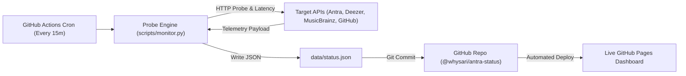

# Antra Status Monitor

[](https://github.com/whysari/antra-status/actions/workflows/monitor.yml)
[](https://whysari.github.io/antra-status/)
[](https://opensource.org/licenses/MIT)

A lightweight, automated, real-time health and latency monitoring platform for the [Antra](https://github.com/anandprtp/Antra) lossless music library builder and its underlying stream resolvers.

**Live Status Dashboard:** [https://whysari.github.io/antra-status/](https://whysari.github.io/antra-status/)

---

## Architecture & How It Works ($0 Serverless Infrastructure)



1. **Automated Probe Scheduling:** A GitHub Actions workflow (`.github/workflows/monitor.yml`) runs every 15 minutes (or via manual trigger).
2. **Sub-second Latency Measurement:** The Python probe engine (`scripts/monitor.py`) sends non-intrusive HEAD/GET requests with custom user-agents, recording response latency in milliseconds (`ms`).
3. **Rolling 30-Day Historical Uptime:** Tracks daily availability blocks, generating an interactive Datadog/Vercel-style status bar.
4. **Git-Driven Telemetry:** Updates `data/status.json` and automatically triggers a build to GitHub Pages.

---

## Monitored Services

| Service | Target URL | Type | Expected Status |
| :--- | :--- | :--- | :---: |
| **Antra GitHub Releases** | `api.github.com/repos/anandprtp/Antra/releases/latest` | Core Release Gateway | 200 |
| **Antra Core Manifest** | `raw.githubusercontent.com/anandprtp/Antra/main/README.md` | Raw Documentation & Spec | 200 |
| **Deezer API** | `api.deezer.com/version` | Lossless Stream Resolver | 200 |
| **MusicBrainz API** | `musicbrainz.org/ws/2/` | Audio Metadata Provider | 200 |
| **Spotify Web Gateway** | `open.spotify.com` | Web Source Ingestion | 200 |

---

## How to Add Your Own Custom Endpoints

Simply add a new JSON object to `config.json`:

```json
{
  "id": "my-custom-service",
  "name": "My Custom Server / API",
  "category": "Backend Infrastructure",
  "url": "https://api.myserver.com/healthz",
  "method": "GET",
  "expected_status": 200,
  "timeout_seconds": 10
}
```

Run the probe locally to verify:
```bash
python3 scripts/monitor.py
```

---

## Run Locally

```bash
# Clone the repository
git clone https://github.com/whysari/antra-status.git
cd antra-status

# Run the probe engine (Uses pure Python standard library, zero pip installs needed)
python3 scripts/monitor.py

# Open dashboard in browser
open index.html
```

---

## License

This project is licensed under the MIT License - see the [LICENSE](LICENSE) file for details.
